<p align="center">
  <picture>
    <source media="(prefers-color-scheme: dark)" srcset="docs/images/logo-dark.png">
    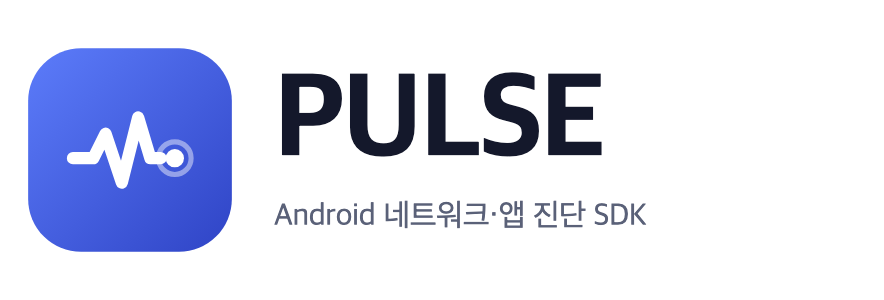
  </picture>
</p>

<p align="center">
  <a href="https://central.sonatype.com/artifact/com.naurylab/pulse-bundle"></a>
  
  
  <a href="LICENSE"></a>
</p>

**PULSE**는 개발 중인 Android 앱 안에서 바로 쓰는 디버깅 SDK입니다.
OkHttp 요청과 응답, 앱 로그, 크래시와 메인 스레드 멈춤, 화면 성능을 하나의 타임라인에 모아 보여 줍니다. 테스트 중에 문제를 발견하면 그 자리에서 스크린샷과 관련 기록을 첨부해 버그 보고까지 작성할 수 있습니다.
토큰이나 비밀번호 같은 민감한 값은 **기기에 저장하기 전에** 마스킹합니다. release 빌드에서는 같은 API를 가진 no-op 모듈로 대체되므로 수집 코드가 포함되지 않습니다.

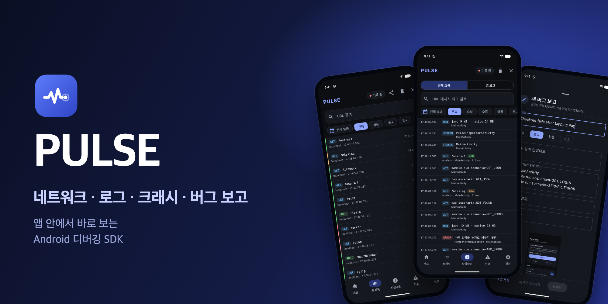

## 기능

- **네트워크**: 연결한 `OkHttpClient`의 요청, 응답, 실패를 기록합니다. DNS 조회, 연결, TLS, 응답 대기까지 단계별 소요 시간과 실제로 주고받은 헤더, JSON 본문(트리 보기와 원문)을 확인할 수 있습니다. 요청 결과에는 영향을 주지 않습니다.
- **통합 타임라인**: 요청, 로그, 사용자 행동, 화면 전환, 오류, 성능 이벤트를 시간순으로 한 목록에 보여 줍니다. 상세 화면의 "연결된 근거"는 같은 스팬에 속한 요청처럼 확실히 연결된 항목과, 같은 화면이나 비슷한 시점에 일어난 항목을 구분해 보여 줍니다.
- **앱 진단**: 크래시(프로세스가 종료되기 직전에 저장), 이전 세션의 종료 이유(ANR, 네이티브 크래시, 메모리 부족), 메인 스레드 멈춤과 스택 트레이스, 콜드 스타트와 화면 로딩 시간, 프레임 드롭, 메모리, 이 앱의 logcat
- **사용자 행동 기록**: 탭과 뒤로 가기를 자동으로 기록합니다(View id와 Compose testTag만 남기고 입력한 텍스트는 남기지 않음). `Pulse.action`, `Pulse.mark`, `Pulse.beginSpan`으로 의미 있는 행동과 스팬(구간)을 직접 표시할 수 있고, 화면 위 플로팅 버튼으로도 마커, 스팬, 스크린샷을 남길 수 있습니다.
- **버그 보고**: 현재 화면을 첨부해 보고서를 작성합니다. 개인정보는 블러가 아니라 픽셀 자체를 덮어써 마스킹하고, 추천된 관련 기록을 골라 재현 패키지(ZIP)로 내보내거나 팀 서버로 전송합니다. 전송 대상, 인증, 재시도 방식은 앱에서 정합니다.
- **대시보드와 이슈**: 성공률, 지연 시간 백분위, 엔드포인트별 오류, 크래시 없는 세션 비율, 날짜별 사용 시간을 보여 줍니다. 원인별로 묶은 이슈와 진단 규칙(느린 요청, 오류 급증, N+1 의심 등), 두 세션 비교도 제공합니다.
- **기간과 세션 필터**: 오늘, 어제, 7일, 30일 또는 달력에서 고른 기간으로 볼 수 있습니다. 세션 하나를 고르면 모든 탭에 적용되어 야간 자동 테스트 결과를 확인할 때 유용합니다.
- **도구**: 요청 재실행(허용한 호스트만), 모의 응답, 네트워크 장애 모사(지연, 실패, 429/503), 화면 구조(View, Compose), 로컬 데이터(등록한 SharedPreferences와 DB, 민감한 값은 마스킹), 환경 값과 기능 플래그, WebView 기록
- **내보내기와 공유**: HAR 1.2, JSON, CSV, Markdown, cURL, 로그(텍스트, JSON, CSV), 원격 오류 보고를 지원합니다. 모든 내보내기는 직전에 한 번 더 마스킹합니다.
- **release 빌드**: `pulse-noop`이 같은 API를 제공하므로 코드를 바꾸지 않아도 수집, 저장, 인스펙터 화면이 모두 빠집니다(release APK 크기 증가 약 2KB).

## 화면

인스펙터는 시스템의 다크 모드와 라이트 모드를 따르고, 폴더블과 태블릿처럼 넓은 화면에서는 목록과 상세를 두 칸으로 나눠 보여 줍니다.

### 다크 모드

<table>
  <tr>
    <td align="center" width="25%"><br><b>트래픽</b><br>메서드, 결과, 소요 시간</td>
    <td align="center" width="25%"><br><b>요청 상세</b><br>요약, 헤더, 본문, 타이밍</td>
    <td align="center" width="25%"><br><b>통합 타임라인</b><br>요청, 행동, 오류를 한 목록에</td>
    <td align="center" width="25%"><br><b>네트워크 대시보드</b><br>성공률, 지연 시간, 엔드포인트</td>
  </tr>
  <tr>
    <td align="center">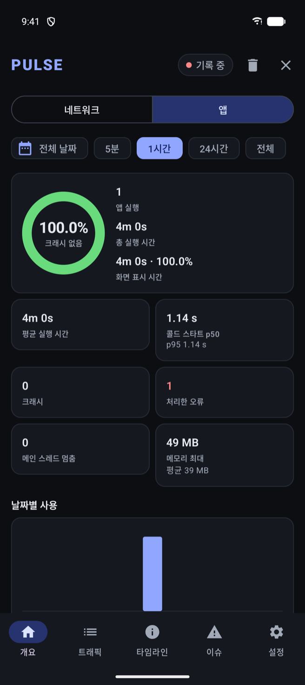<br><b>앱 대시보드</b><br>크래시 없는 세션 비율과 성능</td>
    <td align="center">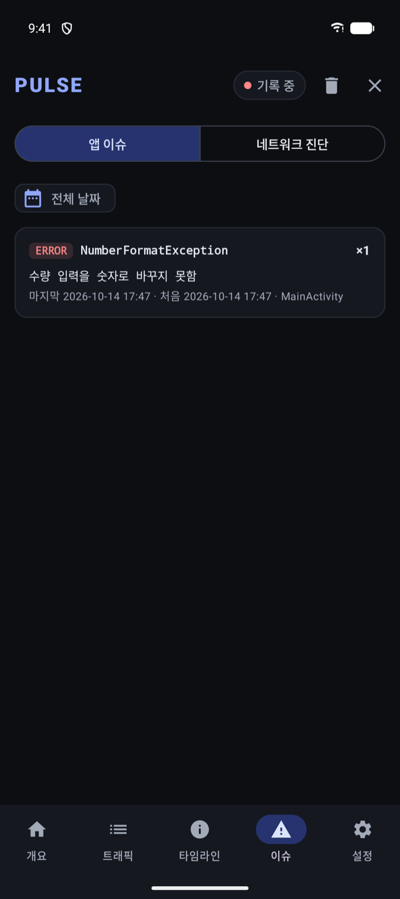<br><b>이슈</b><br>원인별 이슈와 네트워크 진단</td>
    <td align="center">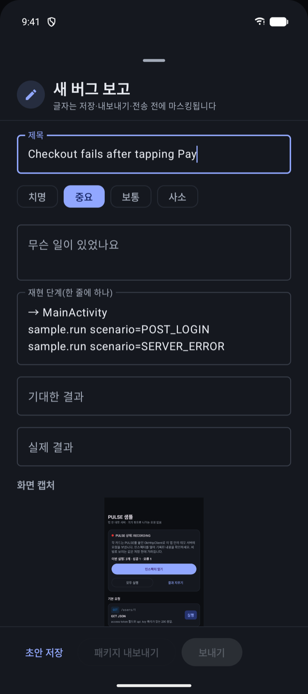<br><b>버그 보고</b><br>재현 단계, 관련 기록, 전송</td>
    <td align="center">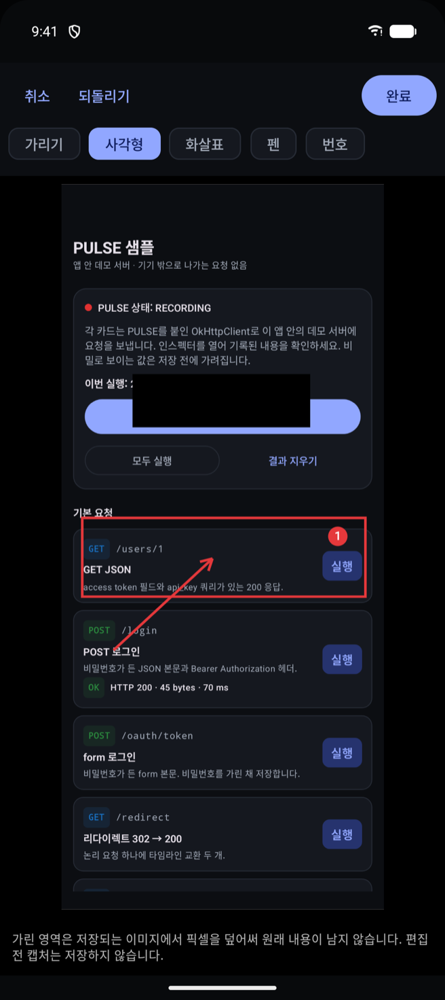<br><b>스크린샷 편집</b><br>가리기, 화살표, 번호</td>
  </tr>
</table>

### 라이트 모드

<table>
  <tr>
    <td align="center" width="25%">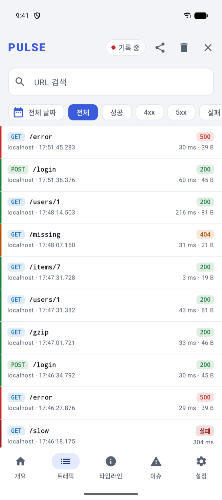<br><b>트래픽</b><br>메서드, 결과, 소요 시간</td>
    <td align="center" width="25%">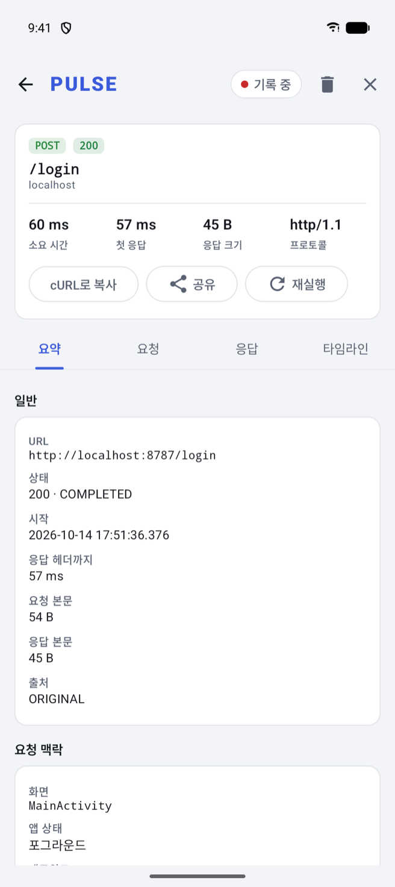<br><b>요청 상세</b><br>요약, 헤더, 본문, 타이밍</td>
    <td align="center" width="25%">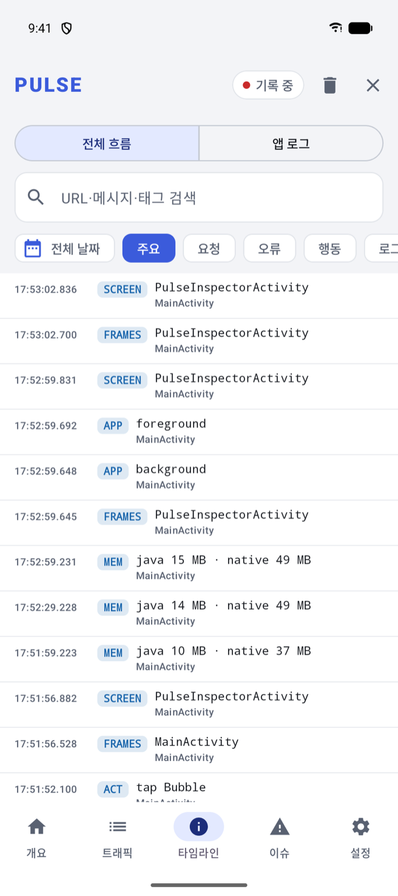<br><b>통합 타임라인</b><br>요청, 행동, 오류를 한 목록에</td>
    <td align="center" width="25%">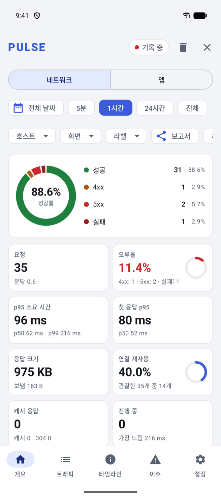<br><b>네트워크 대시보드</b><br>성공률, 지연 시간, 엔드포인트</td>
  </tr>
  <tr>
    <td align="center">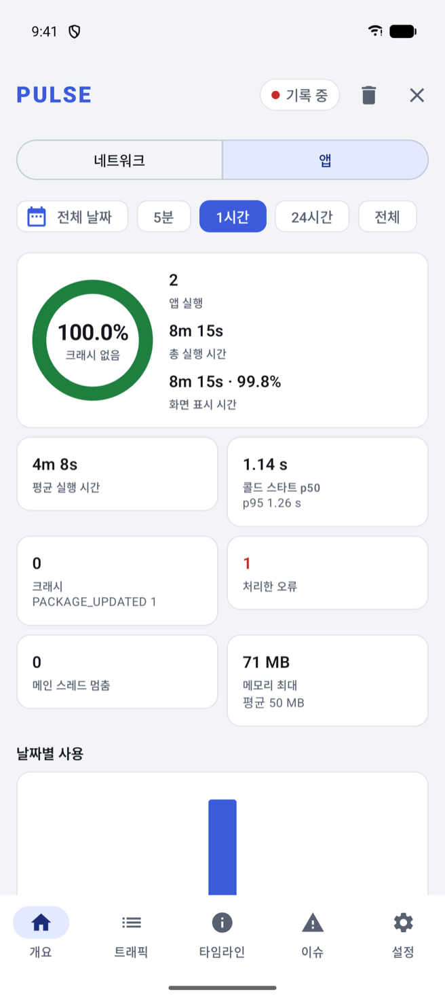<br><b>앱 대시보드</b><br>크래시 없는 세션 비율과 성능</td>
    <td align="center">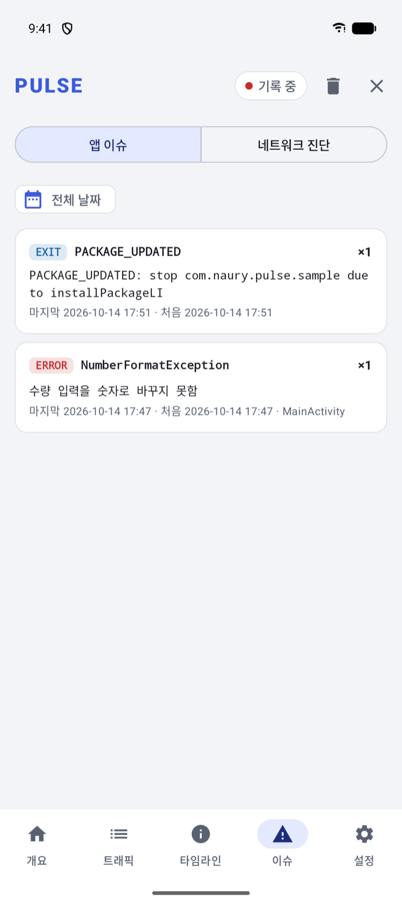<br><b>이슈</b><br>원인별 이슈와 네트워크 진단</td>
    <td align="center">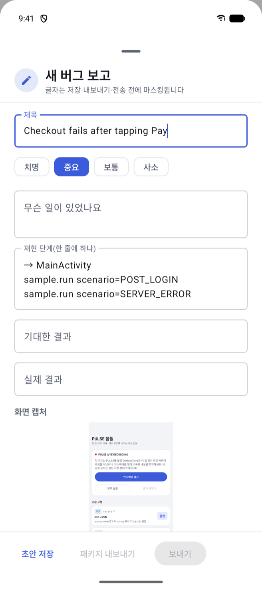<br><b>버그 보고</b><br>재현 단계, 관련 기록, 전송</td>
    <td align="center">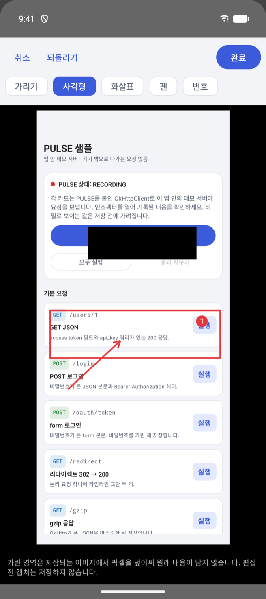<br><b>스크린샷 편집</b><br>가리기, 화살표, 번호</td>
  </tr>
</table>

### 폴드·태블릿

<table>
  <tr>
    <td align="center" width="33%">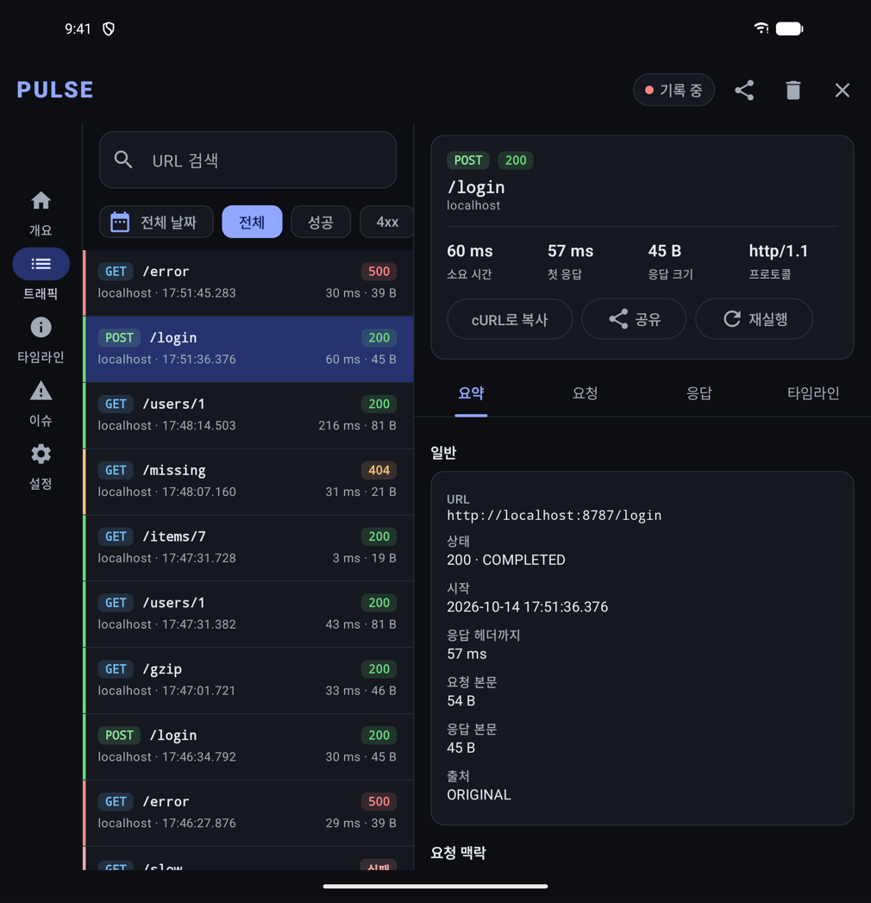<br><b>트래픽</b><br>목록과 상세를 두 칸으로</td>
    <td align="center" width="33%">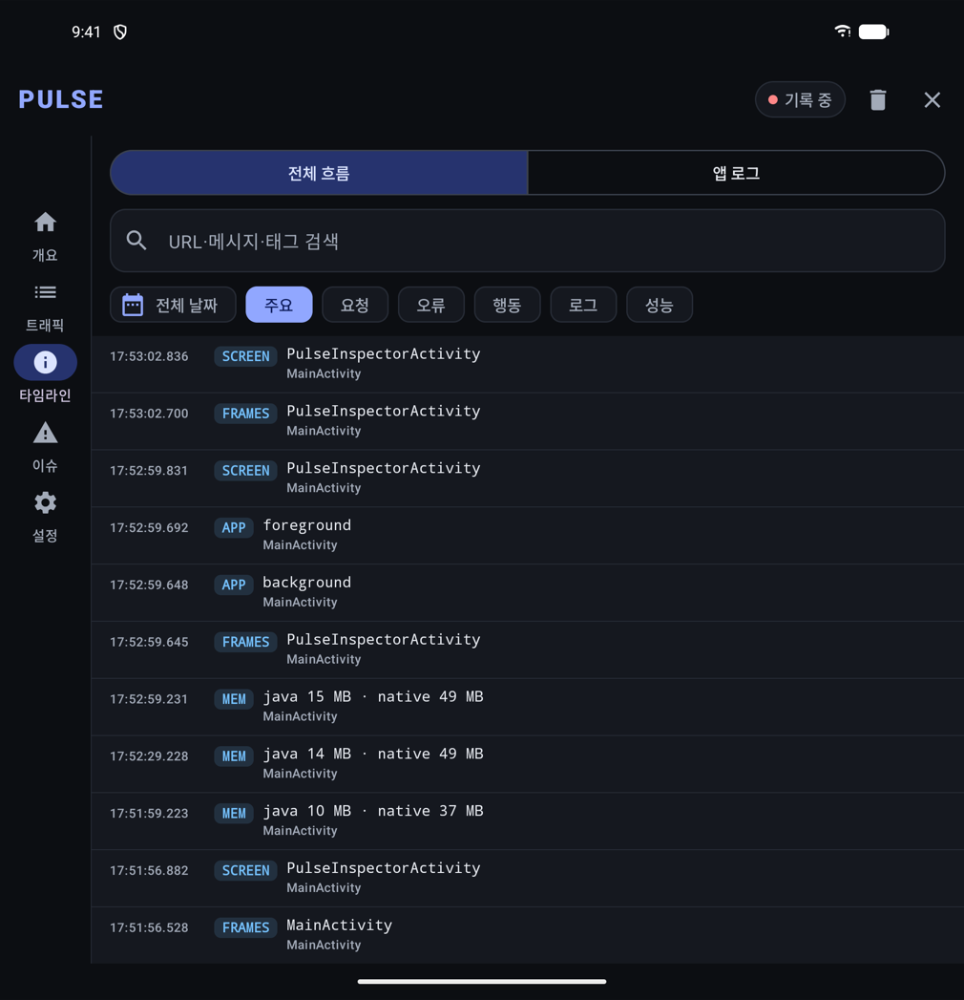<br><b>타임라인</b><br>내비게이션 레일</td>
    <td align="center" width="33%">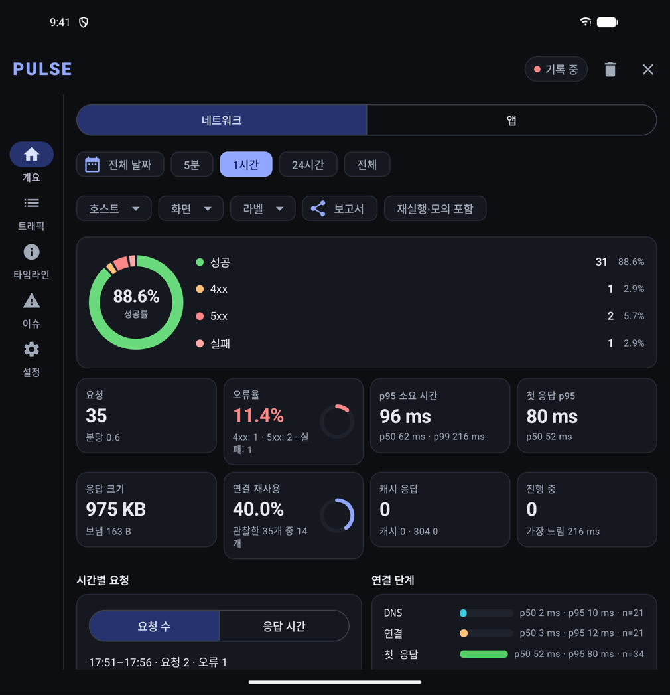<br><b>대시보드</b><br>넓은 화면에 맞춘 카드 배치</td>
  </tr>
</table>

위 스크린샷은 `sample-app` debug 빌드를 Android 16(API 36) 폴더블 에뮬레이터에서 실행해 캡처한 실제 화면입니다.

## 샘플 앱

소스를 빌드하지 않고도 바로 써 볼 수 있도록 샘플 앱(APK)을 [Releases](https://github.com/Naury74/PULSE-Development-Kit/releases/latest)에 올려 두었습니다. 앱에 내장된 데모 서버로 성공, 오류, 타임아웃, 큰 본문 같은 요청을 보내 보고, 로그, 스팬, 오류, 메인 스레드 멈춤, 크래시도 직접 발생시켜 인스펙터에서 바로 확인할 수 있습니다. 인터넷 연결 없이 동작합니다.

- [샘플 앱 내려받기 (pulse-sample.apk)](https://github.com/Naury74/PULSE-Development-Kit/releases/latest/download/pulse-sample.apk)
- Android 8.0(API 26) 이상에서 설치할 수 있습니다. 처음 설치할 때 "출처를 알 수 없는 앱" 설치를 허용해야 합니다.
- 설치하면 런처에 데모 앱인 **PULSE 샘플**과 인스펙터를 바로 여는 **PULSE** 아이콘이 함께 생깁니다.

## 설치

```kotlin
// settings.gradle.kts
dependencyResolutionManagement {
    repositories {
        google()
        mavenCentral()
    }
}

// app/build.gradle.kts
dependencies {
    debugImplementation("com.naurylab:pulse-bundle:0.1.0-alpha01")      // 수집과 저장
    debugImplementation("com.naurylab:pulse-ui-compose:0.1.0-alpha01")  // 인스펙터 화면
    releaseImplementation("com.naurylab:pulse-noop:0.1.0-alpha01")      // 같은 API를 제공하는 no-op 구현
}
```

- minSdk 26, OkHttp 5, Kotlin 2.2 이상이 필요합니다. 앱이 Compose를 쓰지 않아도 인스펙터는 사용할 수 있습니다.
- 별도의 R8/ProGuard 규칙은 필요 없습니다.

| 모듈 | 내용 |
| --- | --- |
| `pulse-bundle` | 수집, 저장, 분석 기능 전체와 진입점인 `Pulse`, `PulseHandle`(debug용) |
| `pulse-ui-compose` | 인스펙터 화면, 런처 아이콘, 알림, 플로팅 버튼 |
| `pulse-noop` | release용. `pulse-bundle`과 API가 같고 아무 동작도 하지 않음 |
| `pulse-export` | (선택) HAR, JSON, CSV, 재현 패키지를 코드에서 직접 만들 때 사용 |

## 사용법

### 연결하기

```kotlin
class App : Application() {
    lateinit var client: OkHttpClient

    override fun onCreate() {
        super.onCreate()
        val pulse = Pulse.initialize(this, PulseConfig.debugDefaults())
        client = OkHttpClient.Builder()
            .addInterceptor(pulse.interceptor())
            .eventListenerFactory(pulse.eventListenerFactory())
            .build()
    }
}
```

이것만으로 네트워크 요청, 크래시와 종료 이유, 메인 스레드 멈춤, 성능, 이 앱의 logcat, 탭과 뒤로 가기가 기록됩니다. 인스펙터는 런처의 **PULSE** 아이콘이나 알림을 눌러 열거나 코드로 열 수 있습니다.

```kotlin
Pulse.open(context)   // UI 모듈이 없거나 release(no-op)이면 false 반환
```

### 행동, 스팬, 로그 남기기

```kotlin
Pulse.action("checkout.submit", mapOf("items" to "3"))   // 의미 있는 사용자 행동. 버그 보고의 재현 단계에 사용됨
val span = Pulse.beginSpan("결제 흐름")                   // 스팬이 열려 있는 동안 시작한 요청은 이 스팬에 연결됨
// …
span?.let(Pulse::endSpan)
Pulse.log(LogLevel.WARN, "Checkout", "쿠폰 만료 임박")
Pulse.recordError(error, "수량 파싱 실패")
Pulse.setFlag("server", "staging")                        // 환경 값이나 실험 플래그. 변경 이력이 남음
```

release 빌드에서는 모두 아무 동작도 하지 않으므로 코드를 지울 필요가 없습니다.

### 버그 보고 보내기

```kotlin
val qa = ReportDestination(
    id = "qa",
    endpoint = "https://qa-collector.example.com/reports",
    allowedHosts = setOf("qa-collector.example.com"),
    headerProvider = { _, _ -> mapOf("Authorization" to "Bearer ${tokenStore.freshToken()}") },
)
PulseConfig.debugDefaults().newBuilder()
    .reporting(Reporting(manual = qa, crash = qa))
    .build()
```

전송 대상을 지정하지 않으면 보고는 기기에 저장되고 ZIP으로 내보내기만 할 수 있습니다. Retrofit 등 앱의 네트워크 모듈로 보내려면 `ReportTransport`를 구현해 넘기면 됩니다. 자세한 내용은 [docs/bug-reports.md](docs/bug-reports.md)를 참고하세요.

인스펙터를 앱의 Compose 화면 안에 넣으려면 `PulseInspectorScreen(inspector = pulse, onClose = { … })`을 사용하세요. Java에서 사용하는 방법은 [docs/java.md](docs/java.md)를 참고하세요.

## 문서

| 문서 | 내용 |
| --- | --- |
| [getting-started.md](docs/getting-started.md) | 설치, 초기화, 기존 EventListener와 함께 쓰기, 인스펙터 열기 |
| [configuration.md](docs/configuration.md) | `PulseConfig`의 모든 설정과 기본값, 화면 리소스 |
| [app-monitoring.md](docs/app-monitoring.md) | 로그, 크래시, 성능, 사용자 행동, 타임라인, 세션 비교, 화면 구조, 로컬 데이터, WebView |
| [bug-reports.md](docs/bug-reports.md) | 버그 보고와 스크린샷 마스킹, 재현 패키지와 뷰어, 보고 전송 대상, 장애 모사 |
| [remote-reporting.md](docs/remote-reporting.md) | 원격 오류 보고 설정과 수신 서버가 받는 형식 |
| [capture-semantics.md](docs/capture-semantics.md) | 무엇을 언제 기록하는지, 본문 상태와 타이밍 값의 의미 |
| [privacy-and-export.md](docs/privacy-and-export.md) | 마스킹 규칙, 저장 위치, 내보내기 |
| [replay-and-mocks.md](docs/replay-and-mocks.md) | 재실행과 모의 응답의 안전장치 |
| [java.md](docs/java.md) | Java에서 사용하기 |
| [architecture.md](docs/architecture.md) | 모듈 구성과 데이터 흐름 |
| [security-audit.md](docs/security-audit.md) | 위협별 대응 방식과 이를 검증하는 테스트 |

## 알려진 제한 사항

- 연결한 `OkHttpClient`의 요청만 기록합니다. WebView 네트워크, Cronet, `HttpURLConnection`, 다른 앱의 트래픽은 기록하지 않습니다. WebView는 페이지 이동, 오류, 콘솔 메시지만 기록합니다.
- 본문은 기본적으로 JSON만 저장합니다. form과 텍스트 본문은 `BodyFormats`로 켤 수 있습니다. multipart, 바이너리 본문과 WebSocket 프레임은 기록하지 않습니다.
- 마스킹은 헤더, 쿼리 파라미터, JSON 키의 이름을 기준으로 동작합니다. 이름만으로는 민감한지 알 수 없는 필드에 개인정보가 담긴다면 `withSensitiveNames`로 직접 추가해야 합니다.
- 네이티브 크래시와 ANR은 발생 시점에 잡지 못하고, 다음 앱 실행 때 시스템이 남긴 기록(Android 11+)을 읽어 저장합니다.
- 저장된 데이터는 암호화하지 않습니다. 대신 앱 전용이면서 백업에서 제외되는 폴더에 저장합니다. 성능 오버헤드는 JVM에서만 측정했고 실제 Android 기기에서는 아직 측정하지 않았습니다.
- 0.x 버전 동안에는 공개 API가 바뀔 수 있습니다.

## 빌드

```bash
./gradlew check :sample-app:assembleDebug :sample-app:assembleRelease
```

`check`는 단위 테스트와 Robolectric 테스트, Android Lint, ktlint, detekt, 공개 API 검사(`checkKotlinAbi`, `verifyNoopApi`), release 런타임 검사(`verifyReleaseClasspath`)를 실행합니다. 기여 방법은 [CONTRIBUTING.md](CONTRIBUTING.md), 변경 내역은 [CHANGELOG.md](CHANGELOG.md), 보안 취약점 신고는 [SECURITY.md](SECURITY.md)를 참고하세요.

## 라이선스

[Apache License 2.0](LICENSE)
