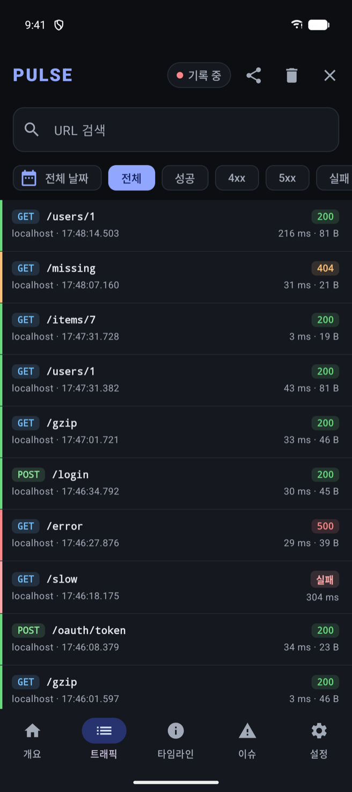
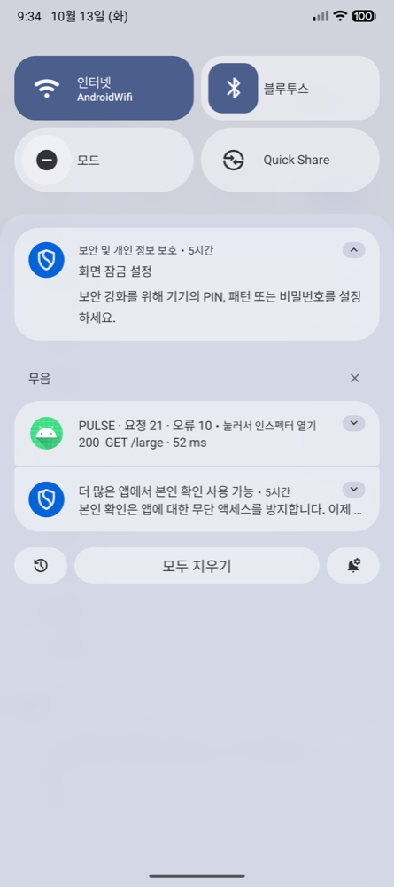
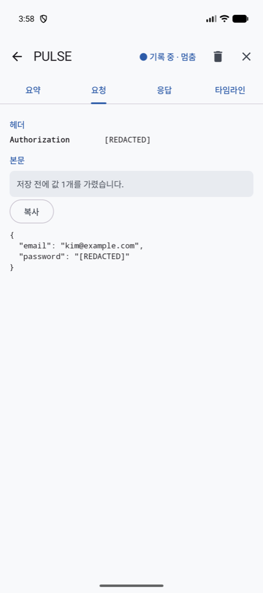
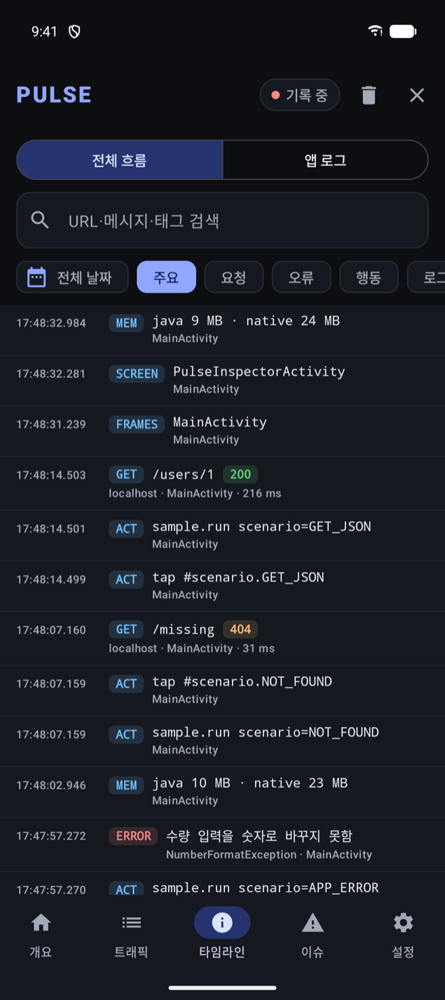
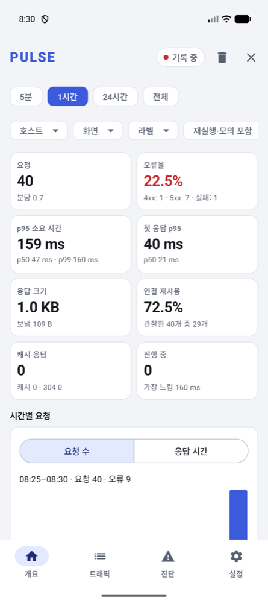
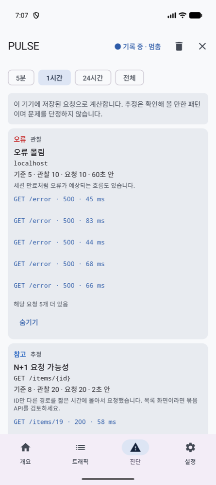
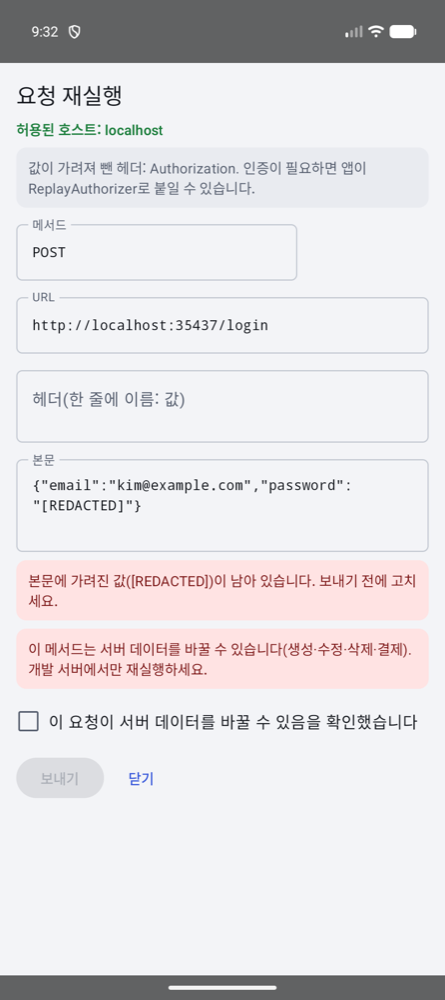
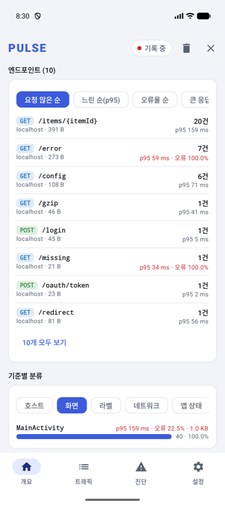

# PULSE

> **WIP** — 아직 Maven Central에 배포하지 않았습니다. 공개 API는 0.x 동안 바뀔 수 있습니다.

**PULSE**는 Android 앱의 OkHttp 요청을 기기 안에서 안전하게 기록하고 살펴보는 네트워크 인스펙터 SDK입니다.
연결한 `OkHttpClient`를 지나는 요청만 기록하며, 비밀 값은 **저장하기 전에** 가립니다. 호스트 앱이 받는 응답·예외·스트리밍 동작은 바뀌지 않습니다.

<table>
  <tr>
    <td align="center" width="25%"><br><b>트래픽</b><br>메서드·결과·소요 시간</td>
    <td align="center" width="25%"><br><b>알림</b><br>앱 어디서든 열기</td>
    <td align="center" width="25%"><br><b>요청</b><br>요약·저장 전 마스킹</td>
    <td align="center" width="25%"><br><b>타임라인</b><br>단계·응답 대기</td>
  </tr>
  <tr>
    <td align="center"><br><b>대시보드</b><br>필터·지표 8개·추이</td>
    <td align="center"><br><b>진단</b><br>기준값·관찰값·근거 요청</td>
    <td align="center"><br><b>재실행</b><br>허용 호스트·위험 확인</td>
    <td align="center"><br><b>엔드포인트·분류</b><br>템플릿 묶음·화면·라벨별</td>
  </tr>
</table>

화면은 `sample-app` debug 빌드를 Android 16(API 36) 에뮬레이터에서 실행한 실제 화면입니다.

## 기능

- **바로 열기**: 앱에 버튼을 달지 않아도 debug 빌드에 PULSE 런처 아이콘과 알림(요청 수·오류·최근 요청, 멈춤·지우기)이 생김. 둘 다 리소스 값으로 끌 수 있음
- **요청 공유**: 요청 하나를 결과·헤더·본문·cURL이 담긴 Markdown 글로 공유해 이슈나 메신저에 바로 붙임
- **기록**: 메서드, 마스킹한 URL·헤더, 상태 코드, 실패 종류(I/O 실패·취소·시간 초과와 4xx·5xx 응답을 구분), 크기, 소요 시간
- **본문**(선택): JSON(설정하면 form·텍스트도), 상한 안에서, 호스트가 실제로 읽거나 쓴 바이트만 복사해 마스킹한 뒤 저장. 트리·원문 보기
- **단계 타이밍**: OkHttp `EventListener`가 관찰한 DNS·연결·TLS·요청·응답 단계, 캐시 응답·연결 재사용 근거. 관찰하지 못한 값은 추정하지 않음
- **대시보드**: 기간·호스트·화면·라벨로 거른 요청 수·분당 요청·오류율·p50~p99·첫 응답 시간·전송량·연결 재사용·캐시, 응답 시간 추이와 분포, 상태 코드·실패 종류, DNS·연결·TLS 단계, 정렬 가능한 엔드포인트 표(`/users/{id}`로 묶음), 화면·라벨·호스트·네트워크·앱 상태별 분류
- **수집 옵션**: 호스트·경로 필터, 요청을 보낸 화면·앱 상태·네트워크 종류, 요청 라벨(`PulseLabel`), form·텍스트 본문(선택)
- **진단**: 진단 규칙 6개(느린 요청, 오류 몰림, 동시 중복 GET, 큰 응답, N+1 추정, 캐시 후보). 결과마다 기준값·관찰값·근거 요청을 보여 주고 추정 규칙은 추정이라고 밝힘
- **내보내기**: HAR 1.2·PULSE JSON을 사용자가 고른 위치에 스트리밍으로 저장(내보낼 때 다시 마스킹), cURL 복사
- **재실행**(선택, 기본 꺼짐): 허용한 호스트에만, 가려진 자격 증명은 빼고, 상태를 바꾸는 요청은 확인 후 보냄. 리다이렉트도 단계마다 검사. 원본과 결과 비교
- **모의 응답**(선택, 기본 꺼짐): 직접 붙인 interceptor가 규칙에 맞는 요청에 합성 응답. MOCK으로 따로 기록
- **보관**: Room DB와 백업 제외 폴더, 건수·기간·본문 용량 상한, 앱이 죽어 끝나지 않은 요청은 "중단"으로 표시
- **release 빌드**: 같은 API의 `pulse-noop`으로 바꾸면 수집·저장·화면 코드가 들어가지 않음

## 시작하기

배포 전이므로 지금은 `./gradlew publishToMavenLocal`로 로컬 Maven에 올린 뒤 씁니다. 자세한 내용은 [docs/getting-started.md](docs/getting-started.md).

```kotlin
// settings.gradle.kts의 repositories에 mavenLocal() 추가

// app/build.gradle.kts
dependencies {
    debugImplementation("com.naurylab:pulse-bundle:0.1.0-alpha01")      // 수집·저장
    debugImplementation("com.naurylab:pulse-ui-compose:0.1.0-alpha01")  // 인스펙터 화면(선택)
    releaseImplementation("com.naurylab:pulse-noop:0.1.0-alpha01")      // 같은 API, 아무것도 하지 않음
}
```

```kotlin
class App : Application() {
    lateinit var client: OkHttpClient

    override fun onCreate() {
        super.onCreate()
        val pulse = Pulse.initialize(this, PulseConfig.debugDefaults())
        client = OkHttpClient.Builder()
            .addInterceptor(pulse.interceptor())
            .eventListenerFactory(pulse.eventListenerFactory())
            .build()
    }
}

// 인스펙터 열기. 화면 모듈이 없거나 release(no-op)면 false
Pulse.open(context)
```

Compose 화면 안에 넣으려면 `PulseInspectorScreen(inspector = pulse, onClose = { ... })`, Java는 [docs/java.md](docs/java.md)를 보세요.

## 문서

| 문서 | 내용 |
| --- | --- |
| [getting-started.md](docs/getting-started.md) | 설치, 초기화, 기존 EventListener와 함께 쓰기, 화면 열기 |
| [configuration.md](docs/configuration.md) | `PulseConfig`의 모든 설정과 기본값 |
| [capture-semantics.md](docs/capture-semantics.md) | 무엇을 언제 기록하는지, 본문 상태, 타이밍의 의미 |
| [privacy-and-export.md](docs/privacy-and-export.md) | 마스킹 규칙, 저장 위치, 내보내기 |
| [replay-and-mocks.md](docs/replay-and-mocks.md) | 재실행과 모의 응답의 안전 장치 |
| [java.md](docs/java.md) | Java에서 쓰기 |
| [architecture.md](docs/architecture.md) | 모듈 구성과 데이터 흐름 |
| [benchmarks.md](docs/benchmarks.md) | 측정 방법과 결과(JVM, 기기 측정 전) |
| [security-audit.md](docs/security-audit.md) | 위협별 대응과 확인하는 테스트 |
| [adr/](docs/adr) | 설계 결정 |

## 알려진 제한

- 연결한 `OkHttpClient`의 요청만 기록합니다. WebView, Cronet, `HttpURLConnection`, 다른 앱의 트래픽은 기록하지 않습니다.
- application interceptor 위치에서 기록하므로 OkHttp가 나중에 붙이는 헤더(`Host`, `Accept-Encoding`, 쿠키 저장소의 쿠키)는 보이지 않습니다.
- 본문은 JSON만 저장합니다(form·텍스트는 `BodyFormats`로 켬). multipart·바이너리와 WebSocket 프레임은 기록하지 않습니다.
- 저장 데이터는 암호화하지 않습니다. 스크린샷 차단은 아직 없습니다.
- 성능은 JVM에서만 쟀고 Android 기기 측정은 아직입니다.

## 빌드

```bash
./gradlew check :sample-app:assembleDebug :sample-app:assembleRelease
```

`check`는 단위·Robolectric 테스트, Android Lint, ktlint, detekt, 공개 API 검사(`checkKotlinAbi`, `verifyNoopApi`), release 런타임 검사(`verifyReleaseClasspath`)를 실행합니다. JDK 25(Android Studio 포함 JBR)를 씁니다. 기여 방법은 [CONTRIBUTING.md](CONTRIBUTING.md), 변경 내역은 [CHANGELOG.md](CHANGELOG.md).

## 라이선스

[Apache License 2.0](LICENSE)
